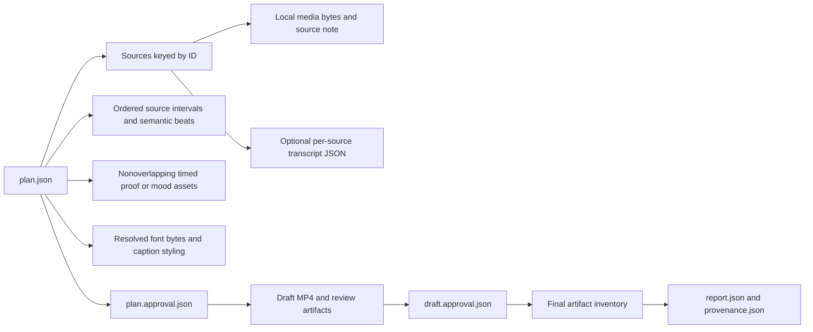

# Filesystem data model — no database

Intended version-1 contract; no tables, SQL columns or HTTP resources. ../api/api-map.md maps host review surfaces to local engine calls. The engine validates actual referenced bytes; filenames alone do not establish approval.

| Artifact | Data and constraints | Ownership |
|---|---|---|
| plan.json | version=1, objective, audience, format, sources, ordered segments, overlays, persona, hook, CTA and strict_3c | Agent proposes; owner approves identified content |
| sources by ID | Local path, source_note, optional transcript path; real file must exist | User-provided media remains unchanged |
| transcript JSON | source, duration, words containing start/end/word; source-relative finite timestamps | Existing transcription shape; never invented speech |
| segments | source_id, start/end within media duration, beat selected by meaning | Output time follows concatenated selected intervals |
| overlays | source_id, source_start, output start/end, role, source_note | Real proof needs provenance; mood is not proof; no overlap |
| persona | Available resolved font, color, highlight and caption style | Font bytes are approval dependencies |
| plan.approval.json | Stage, reason and content fingerprint of canonical plan and referenced dependency bytes | Written only following explicit confirmation |
| draft.approval.json | Same dependency binding plus identified draft MP4 hash | Changed draft requires renewed draft review |
| provenance.json | Actual source references and approved timeline attribution | Exported with the final; no fabricated sources |
| report.json | Actual durations/role mix, artifacts, technical/human/per-host statuses | PASS/FAIL/NOT_CHECKED remain separate |

Canonical approval hashing includes plan semantics and every referenced media/transcript/font/voiceover byte, not modification times. The lifecycle in state-machine.md is derived from valid artifact relationships, not persisted as an editable authority field. Reordered captions are mapped from source word times onto the output timeline; exclusive role durations count each output interval once, with uncovered time assigned to A-roll.

Final delivery inventory: final.mp4, subtitles.srt, contact-sheet.jpg, plan.json, provenance.json and report.json. Approval sidecars are local control artifacts, not proofs of authenticated identity. Unsafe aliases, preexisting final files and failed staging must not overwrite sources or masquerade as successful export. Each batch job owns its output and failure record independently.
