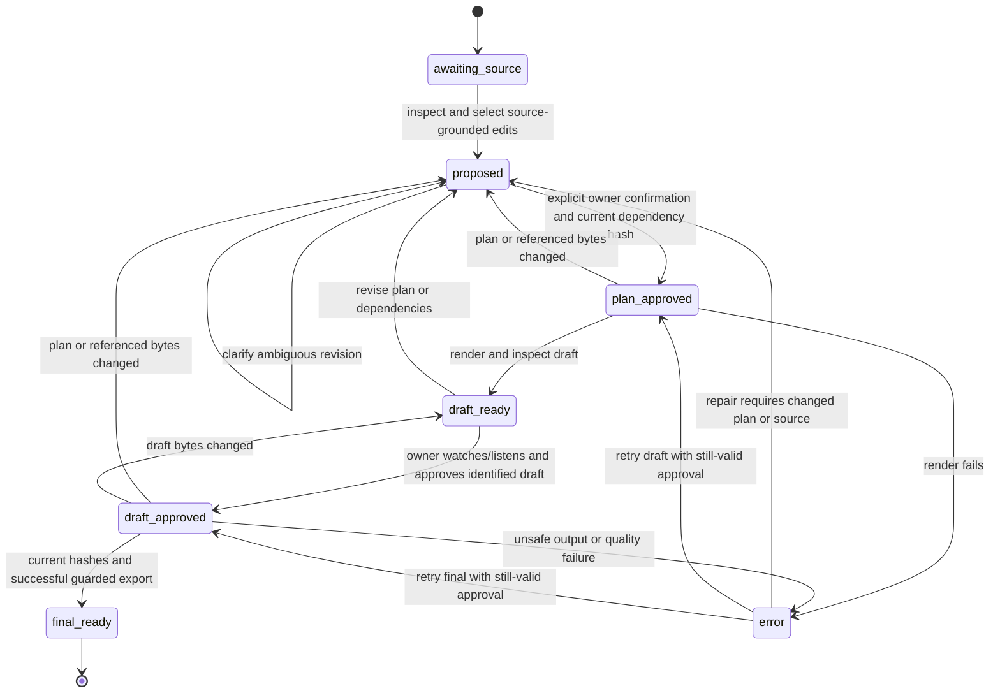

# Review lifecycle

These are conceptual workflow states computed from artifacts and valid hashes, not a database enum or an assertion of implemented runtime behavior. Loading/Empty/Error/Populated are presentation states and do not authorize rendering.

Every transition that consumes approval rechecks bytes, including resolved font, media, transcript and any referenced voiceover. Recheck immediately before final publication to prevent changes during work from producing an incorrectly approved final. Old sidecars can remain for diagnostics but never authorize a changed revision. A stored boolean is neither identity authentication nor evidence of owner confirmation.

Errors preserve diagnostics and sources, not a falsely successful final. Returning from error requires the relevant approval still to match; the diagram is not permission to skip validation. Technical PASS, human review and host execution status are reported separately. A present host installation never implies that its acceptance flow was exercised.
