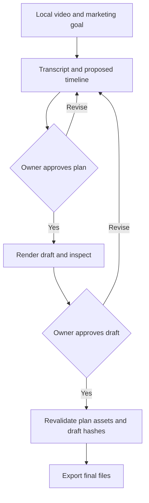

# User flow
Input local video + audience + marketing goal → inspect/transcribe → propose plan → owner approves plan → render draft → inspect video/contact sheet → revise or approve draft → export final.
Empty: request source and goal. Loading: show current stage, never claim final ready. Error: show stable error code and repair action. Populated: show plan, draft, actual role mix and quality findings.
Changes to plan/assets invalidate both approvals; changes to draft invalidate draft approval. No automatic social publishing. Agent operates tools; user never needs JSON.

